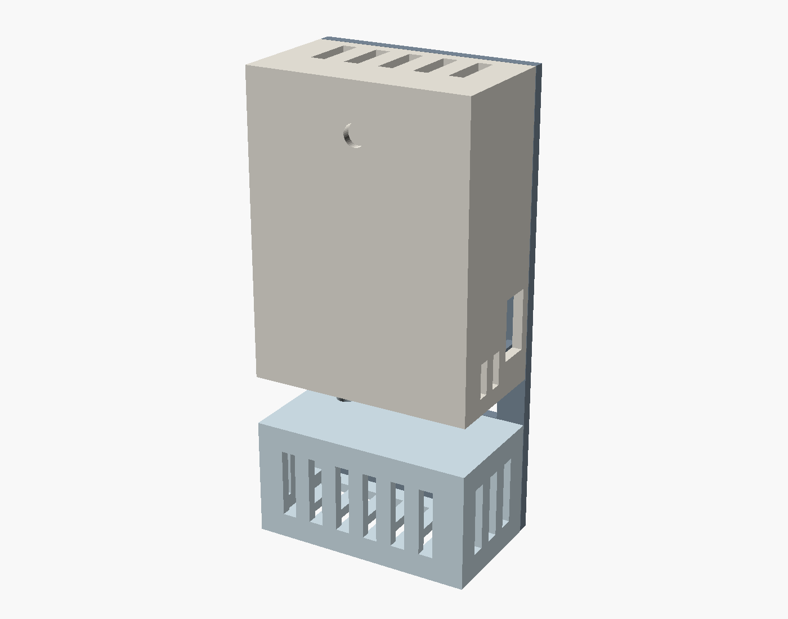
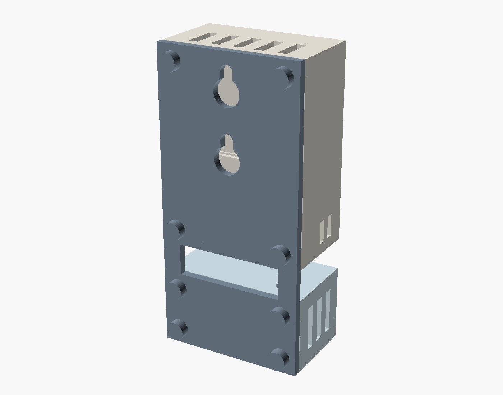
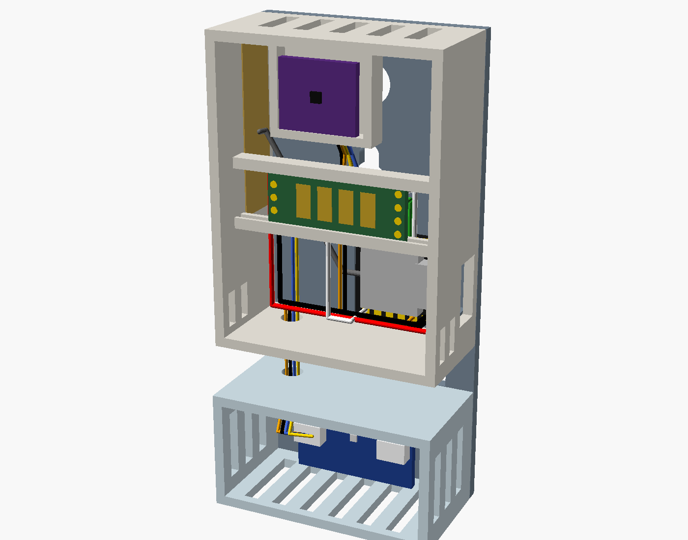
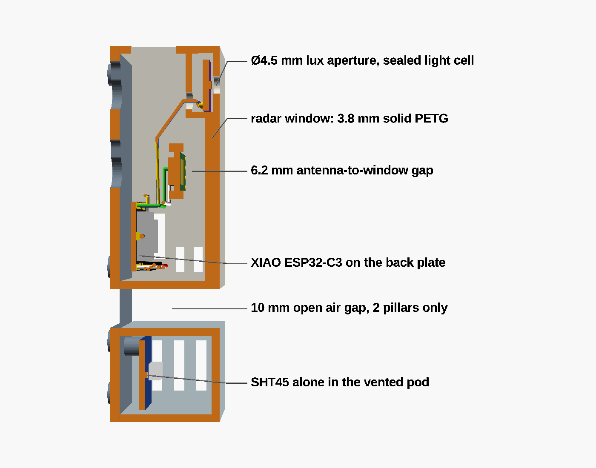
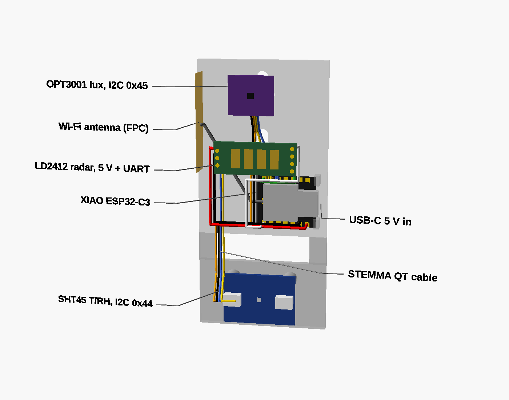
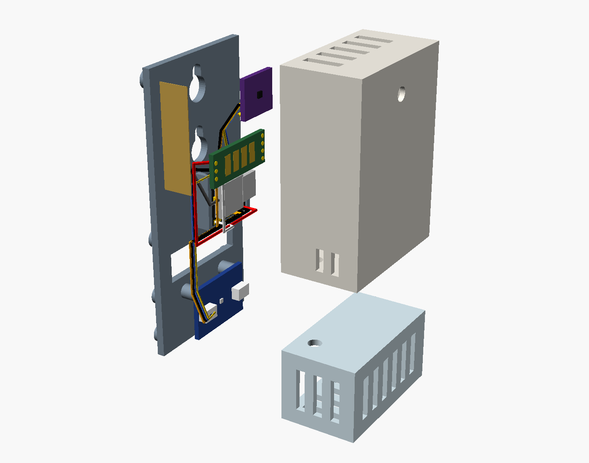
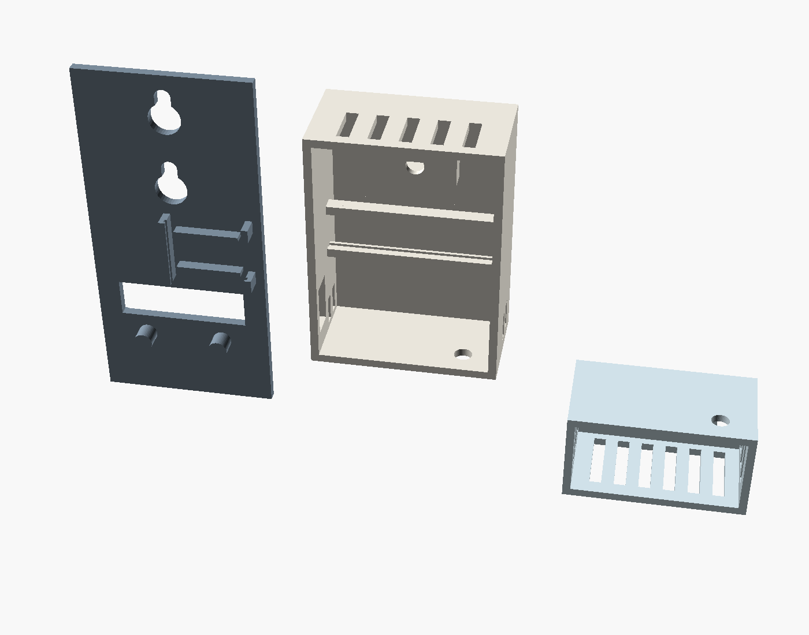
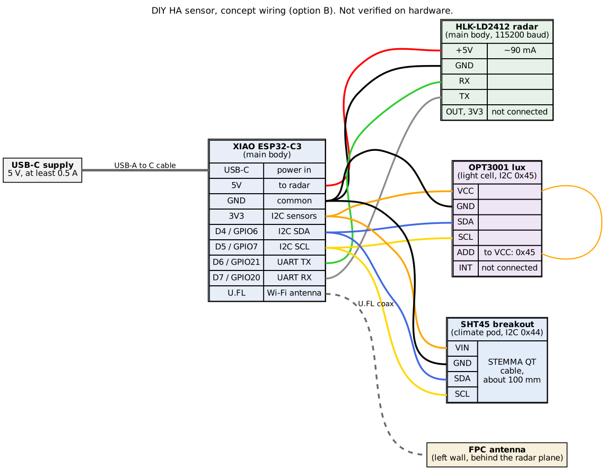

# Design proposal: DIY presence and climate sensor (Phase 0)

- **Date:** 2026-10-15 (checked with `TZ=Europe/Paris date`).
- **Status:** a proposal for Paul to review. Nothing is decided, nothing is ordered, and no firmware has been
  written. The only CAD is a rough concept model, made so the layout can be reviewed (section 6.0); it is not a
  printable design. Once Paul answers section 10 and approves an option, the decisions move into `docs/design_decisions.md`.
- **ESPHome baseline:** 2026.9.1, the current stable release on PyPI on 2026-10-15.

How to read the source tags (full list in section 11):

| Tag | Meaning |
|---|---|
| **[E]** | Checked in the ESPHome 2026.9.1 source (installed locally) or the ESPHome docs source on GitHub |
| **[D]** | Read in a vendor datasheet or application note. Vendor sites are blocked here, so these are copies hosted on GitHub; revisions may be older than the current one |
| **[G]** | Read in a GitHub issue, repository or vendor YAML (community or vendor evidence, not a datasheet) |
| **[S]** | Search-engine snippet only; the page could not be opened. Unverified |
| **[calc]** | My arithmetic from the figures cited |
| **[A]** | Assumption. Needs Paul's answer or a bench test |

## 1. Summary

**Recommended build (option B, section 5):**

- **MCU:** Seeed **XIAO ESP32-C3**, which ships with an external antenna.
- **Radar:** Hi-Link **LD2412**.
- **Temperature and humidity:** genuine Sensirion **SHT45** on an Adafruit breakout.
- **Lux:** **TI OPT3001**, behind an open aperture in a sealed light cell (see 4.3 and 6.4).
- **Enclosure:** a two-part PETG case.
  - The **main body** holds the MCU and radar and vents upward.
  - A small **climate pod** hangs below it, across an open, ventilated air gap.
  - The SHT45 is the only part in the pod.

**What I expect it to cost (estimates, not quotes):**

- Option B: about **€27-35 per unit**, excluding the USB supply.
- Option A (budget): about **€13-22**. It uses a C3 SuperMini, an LD2410C and a genuine SHT40.
- Both come out above the brief's first estimate (€10-12 and €17-20). The main reasons are:
  - genuine Sensirion parts: about €6 for an SHT40 board and €13 for an SHT45, against €1-3 for an unverified one;
  - the XIAO costs about €3 more than a SuperMini.
- No price could be live-checked: every retailer site is blocked from this session (section 9).

**The four evaluate-and-recommend items (section 8):**

| Item | Recommendation |
|---|---|
| CO2 | Optional variant only, not the default |
| Bluetooth proxy | Off. Not on the device that measures temperature |
| LD2450 zone variant | Not now |
| ESP32-C6 | No |

**Biggest risk:** the ±0.5 °C target. The evidence from similar devices is clear:

- slots and cut-outs on a small board still leave errors of 1-5 °C;
- this device dissipates about 0.56 W, most of it in the radar;
- hence the separate pod.

The plan builds and measures **one** unit before Paul builds the rest.

**Unexpected finding:** Apollo's own MSR-2 firmware already subtracts **14.54 °C** from its DPS310 by default
(`DPS Temperature Offset`, Apollo `Core.yaml`) [G]. So the 27.9 °C Paul saw means the raw sensor sat near 42 °C, about
19 °C above the room [calc, A: Paul hasn't changed that offset].

**What I need from Paul before Phase 1:**

1. Answers to the questions in section 10.
2. Network access to a short list of domains, so prices and datasheets can be checked live (section 9).
3. A decision on how to create `main`. The repo is empty, so there is no `main` for this PR to target (section 10,
   question 1).

## 2. Requirements and how the design meets them

| Requirement (from the brief) | How option B meets it | How it will be verified |
|---|---|---|
| Still person detected as reliably as a moving one | LD2412: separate per-gate still thresholds on 14 gates; still detection rated at or above the LD2410 [D][G][S] | Bench step: sit still on the sofa 30 min; presence must not drop (`docs/validation.md`, Phase 4) |
| Presence within about 1 s; clear after a configurable timeout | The radar streams frames over UART; ESPHome publishes on change. LD2412 `timeout` number entity, 0-900 s [E] | Bench step: walk in and time it against HA history |
| 0.1 lx resolution in 0-10 lx; daylight up to tens of klx; light on/off reported within 2 s | OPT3001 auto-ranges in hardware with one 800 ms conversion [E]. Poll every 1 s; delta filter plus heartbeat | Dark-room readings; light-switch step timing against HA history |
| No LED near the lux sensor or leaking into it | Sealed, opaque light cell. No always-on LED on the XIAO (charge LED only, see 4.1). Breakout power LEDs cut or desoldered | Bench step: dark-room reading must stay ≤0.03 lx with the device running |
| T within ±0.5 °C, RH within ±3 % of an SNZB-02D after 1 h | SHT45 (±0.1 °C / ±1.0 %RH typ) [D] in a separate vented pod, away from about 0.56 W of heat | 48 h side-by-side against an SNZB-02D |
| Report every 30-60 s, heartbeat, offsets as HA `number` entities | ESPHome `sht4x` at 30 s, `delta` + `heartbeat` filters; offsets as template numbers with `restore_value` | Config compile in CI; check in HA |
| USB-C 5 V, always powered | XIAO USB-C; radar on 5 V directly | Bench |
| ESPHome, encrypted API, OTA, 2.4 GHz Wi-Fi | Common base package | CI `esphome config` + `compile` |
| Printable on the H2D, ideally without supports; OpenSCAD; STLs; PNG renders | Parts designed to print flat-face-down; parametric OpenSCAD | Phase 3 check scripts |
| Status LED off by default | No status LED driven; any board LED unused or removed | Bench |
| Diagnostics: RSSI, uptime, ESP internal temperature, sensor-fault binary sensors | `wifi_signal`, `uptime`, `internal_temperature`; template binary sensors from each component's failed state | CI compile; check in HA |
| DNS name `<name>.mulet.flypig.net`, no literal IPs | `wifi: use_address: ${name}.mulet.flypig.net`; node name = DNS host label | CI; build guide step |

## 3. What the current sensors get wrong, and the fix

| Problem (measured 2026-10-15) | Cause (evidence) | Fix in this design |
|---|---|---|
| MSR-2 has no humidity | Stock config exposes only CO2 from the SCD40. Apollo declined to expose SCD40 T/RH, citing "the amount of heat generated by the microcontroller and mmWave sensor" (MSR-2 PR #53) [G] | Dedicated SHT45, outside the heated body |
| MSR-2 reads 27.9 C vs 21.6-24.6 C | DPS310 on the main PCB next to the ESP32-C3 and radar. Apollo ships a 14.54 °C default offset to hide this [G] | Sensor in a separate pod below the heat, across an air gap; offset kept only for fine trimming |
| MSR-2 CO2 346 ppm (below outdoor about 420-426 ppm) | SCD4x automatic self-calibration (ASC) assumes it sees 400 ppm at least weekly [D]. The global mean is about 426 ppm (ESPHome docs, March 2025 figure) [E]. A closed room never sees outdoor air | CO2 variant only: forced recalibration outdoors; ASC off, or its target set to about 426 ppm (section 4.5) |
| MSR-2 radar on factory thresholds | Nothing tuned | Gate thresholds exposed as HA numbers; tuning procedure in `docs/calibration.md` (Phase 4) |
| FP300 reports T/RH only on step changes | Battery firmware throttles reports | Mains-powered: 30 s reports plus heartbeat |
| FP300 lux only about hourly | Same | 1 s polling, delta filter, heartbeat |
| FP300 cleared while someone sat still | Unknown: the firmware is closed. A battery-saving radar duty cycle is a likely cause [A] | Continuous 24 GHz radar with still-target gates |

## 4. Component research

### 4.1 Microcontroller

| | ESP32-C3 SuperMini | **XIAO ESP32-C3** | XIAO ESP32-C6 | ESP32-C6 SuperMini |
|---|---|---|---|---|
| ESPHome | Mature; Arduino or ESP-IDF [E] | Same chip | ESP-IDF only [E] | ESP-IDF only [E] |
| Antenna | Chip antenna. Documented bad batches: fails to join, or RSSI around -81 dBm where good boards read -49 dBm (esphome/issues #4893) [G] | **External antenna on U.FL, included** [G] | Ceramic plus U.FL with an RF switch [G] | Chip; CircuitPython derates it to 15 dBm "due to the antenna design" [G] |
| Always-on LED | **Yes: a hardwired power LED** (reverse-engineered netlist) [G]; blue LED on GPIO8 | No user LED; charge LED only [G]. Its behaviour with no battery is **not confirmed** [A] | Charge LED goes off 30 s after power-up with no battery [G] | WS2812 on GPIO8 [G] |
| Wi-Fi modem-sleep current (DTIM1, ESP-IDF figures) | 21.5 mA [D] | 21.5 mA [D] | 27.5 mA [D] | 27.5 mA [D] |
| Size | 22.5 × 18 mm [G] | 21 × 17.8 mm [G] | 21 × 17.8 mm [G] | not found |
| Price each (estimate) | €1.4-2.6 AliExpress; €4.7 in a 6-pack on Amazon.fr [S] | €5.4-5.9 (DigiKey, Gotronic, Botland) [S] | €5.5-6.9 [S] | €1-5 [S] |

**SuperMini Wi-Fi weakness:**

- **Workaround:** `wifi: output_power: 8.5dB`. It fixes association failures for some boards but not all [G]. WLED's C3
  build lowers TX power by default for the same reason [G].
- **Root cause:** not established.
  - One reverse-engineering write-up says the chip antenna is tuned for 2.7 GHz and has no matching network [G].
  - The "antenna too close to the crystal" theory appears only in search snippets [S].
  - The wire-antenna mod gains are unverified [S]. A wire antenna raised RSSI on one bad board but it still would not
    connect [G].
- **Spotting a bad batch:** the only fetchable clue is an early-2024 report that red-antenna boards worked and
  black-antenna boards failed [G]. Treat every SuperMini as suspect, and check RSSI on the bench before installing.

**Recommendation: XIAO ESP32-C3.**

- It removes the SuperMini RF lottery and the hardwired LED for about €3 more per unit.
- It is the same chip as the Apollo, and draws less in modem sleep than a C6, so it makes less heat.
- The SuperMini stays as the budget option A, with `output_power: 8.5dB`, an RSSI check per board, and the power LED
  desoldered.

### 4.2 Radar

| | LD2410C | **LD2412** | LD2450 | LD2420 |
|---|---|---|---|---|
| ESPHome component | `ld2410` [E] | `ld2412` [E] | `ld2450` [E] | `ld2420` [E] |
| Still person | Datasheet polar plot: "sit still" about 4 m on axis (my reading of the plot) [D] | Same claim in datasheet [D]; reviews put static range above LD2410C (about 8 m vs 6 m) [S] | **Poor.** No sensitivity control; ESPHome maintainers confirm still detection is up to the module (esphome #14450) [G] | "Micro-motion" range measured with shrugging or hand-raising, not breathing [D] |
| Gates and thresholds | 9 gates, 0.75 or 0.2 m; per-gate move/still [D][E] | 14 gates, 0.75 / 0.5 / 0.2 m; per-gate move/still; dynamic background correction [E] | No gates; zones only [E] | 16 gates [E] |
| FOV, horizontal | ±60° [D] | ±75° [D] | ±60° [D] | ±60° [D] |
| Mounting | Wall 1.5-2 m, ceiling 2.6-3 m [D] | Wall 1.5-2 m, ceiling 2.6-3 m [D] | Wall only, 1.5-2 m [D] | Wall 1.5-2 m, ceiling 2.7-3 m [D] |
| Supply / average current | 5 V / 79 mA [D] | 5 V or 3.3 V / 90 mA; peak 192 mA [D] | 5 V / 120 mA [D] | 3.3 V only / 50 mA [D] |
| UART | 256000 baud [D] | 115200 baud [D][E] | 256000 [D] | Changes with firmware version [D] |
| Size, pins | 16 × 22 mm, 2.54 mm [D] | 11 × 28 mm, 2.54 mm [D] | 15 × 44 mm, 2.0 / 1.5 mm [D] | 20 × 20 mm [D] |
| Bluetooth on board | Yes; ESPHome switch [E] | Yes; ESPHome switch [E] | Yes | None |
| Price each (estimate) | €1.5-5.7 [S] | €5-6.5 (Domadoo, OpenELAB, SmartHomeShop) [S] | €6.7-7 [S] | €1-4.6 [S] |

**Recommendation: LD2412, with the LD2410C as the fallback.**

- **Why the LD2412:**
  - It has the most still-detection headroom and the finest gates.
  - It has ±75° coverage, and its 2.54 mm pins are easy to wire.
- **LD2412 risks:**
  - **Firmware V1.26** has broken UART configuration: baud rate and engineering mode commands are acknowledged but
    don't apply, and settings revert after about 30 s (esphome #13366, closed as stale) [G]. Check the firmware
    version shown in ESPHome on arrival; if it is V1.26, it must be updated, or swapped for an LD2410C.
  - The datasheet gives no static-range figure [D].
  - Hi-Link lists a "±60° upgrade version" alongside the ±75° part [S]; check which one arrives.
- **LD2410C as a known quantity:** the Apollo already in the great room uses an LD2410B (same family). That gives a
  known-good comparison on day one.
- **Plan:** buy one LD2410C alongside the LD2412s (about €3). The firmware will have a package for each, so the first unit
  can be tested with either.
- **Bluetooth:** both modules ship with on-board Bluetooth enabled. Turn it off from ESPHome after tuning; it draws power
  and Apollo notes it can interfere with nearby Bluetooth devices [G].

### 4.3 Illuminance

The 2 lx on / 1 lx off threshold needs a sensor that resolves well below 0.1 lx after any loss in the case, and
reports a change within 2 s at every light level.

| | **OPT3001** | VEML7700 | BH1750 | LTR390 (the Apollo's) |
|---|---|---|---|---|
| Best resolution | **0.01 lx** at the lowest range (full scale 40.95 lx) [D] | 0.0036 lx/count at gain 2 and 800 ms [D][E] | 0.11 lx/count (H-resolution mode 2, MTreg 254) [D][E] | 0.0083 lx/count at ESPHome defaults [calc] |
| Top of range | 83.9 klx [D] | about 120 klx; ESPHome docs warn of 150-200k+ in direct sun [D][E] | about 100 klx [D] | about 8.7 klx at ESPHome defaults (X18, 20-bit) [calc] |
| Ranging | **Automatic, in hardware**: one setting covers 0.01 lx to 83.9 klx [D] | Gain and integration time must step; no single setting does both [D] | Steps MTreg [E] | None in ESPHome; fixed gain [E] |
| Dark offset | 0-3 codes, ≤0.03 lx [D] | 3 counts typ, about 0.01 lx [D][calc] | Up to 3 counts: up to 2.5 lx at MTreg 69 [D][calc] | 0 typ [D] |
| Spectral match | >99 % IR rejection; 0.2 % response at 850 nm; 4 % variation across light sources [D] | Close to the eye response; ±10 % across sources; reads high under halogen and sun [D] | Incandescent/halogen read about 15-25 % high (datasheet figure) [D] | ±10 % across sources [D] |
| Angular response, half sensitivity | ±47° [D] | ±55° [D] | about ±45-60° [D] | about ±50° [D] |
| Part-to-part accuracy | ±10 % at 2000 lx [D] | ≤10 % [D] | ±20 % [D] | ±10 % [D] |
| ESPHome reading time [E][calc] | About 0.83 s at any light level: one 800 ms conversion | Steps gain, then integration time, restarting from the start values on every update. Starting at gain 2 / 100 ms: about 1.2 s at 2 lx, 2.8 s at 1 lx, about 6 s near 0 lx | About 0.7 s | About 0.4 s |
| I2C address | 0x44 default; 0x45-0x47 by ADDR pin [D][E] | 0x10 [D] | 0x23 / 0x5C [D] | 0x53 [D] |
| Verdict | **Recommended** | Fallback if Paul needs more than 84 klx; "lights off" reports slowly | **Fails**: 0.11 lx, ±20 %, and dark counts worth up to 2.5 lx | Reference only |

**Recommendation: OPT3001.** It is the only candidate that auto-ranges in hardware. ESPHome gets a full reading in
about 0.83 s at any light level [E], so 1 s polling with a delta filter meets the 2 s target. It also has the best
IR rejection, so LED, incandescent and daylight read alike. The 83.9 klx ceiling covers "tens of klx near a window",
and the aperture's reduced field of view raises the effective ceiling further [calc].

**Address clash.** The SHT45 exists only at 0x44 [D], the OPT3001's default address. The ESP32-C3 has a single I2C bus
in ESPHome (`"NUM": 1` in the 2026.9.1 i2c component) [E], so a second bus isn't an option. The OPT3001's ADDR pin must
go to VDD (0x45).

**Breakout boards.** The generic breakout in the ESPHome docs photo has an ADD pin [E], but what it is wired to isn't
known. Phase 1 picks a board where the ADDR pin can be strapped. Paul confirms 0x45 with the I2C scan in the ESPHome
log before final assembly. No price for a generic OPT3001 board could be found.

**Readings will differ from the Apollo.** The Apollo uses a different sensor (LTR390) behind its own window, with
`window_correction_factor` left at 1.0 [G]. A DIY unit will not read the same lux, so if one replaces the Apollo, the
2 lx / 1 lx Arty Player thresholds must be re-tuned. The calibration doc (Phase 4) will say so.

**Calibration against the Apollo (outline for `docs/calibration.md`).**

1. Prepare the Apollo for logging. By default it updates every 60 s, and its "Reduce DB Reporting" switch drops changes
   under 5 lx [G]. Set it to about 5 s and switch Reduce DB Reporting off. Keep its RGB LEDs off.
2. Mount both side by side, facing the same way, and log for several days. The DIY unit logs every 1 s.
3. Resample to 1-minute medians. Drop light transitions, periods where either sensor is saturated (the Apollo clips at
   about 8.7 klx), and any period when an LED was on.
4. Fit the 0-20 lx band and the 20 lx to 8 klx band separately. Compare evening LED light with daylight. Then apply the
   result with ESPHome's `calibrate_linear` filter, using a few fitted points rather than raw scatter.

### 4.4 Temperature and humidity

| | SHT40 | SHT41 | **SHT45** |
|---|---|---|---|
| T accuracy typ / max | ±0.2 / ±0.4 °C [D] | ±0.2 / ±0.4 °C [D] | **±0.1 / ±0.3 °C** [D] |
| RH accuracy typ / max | ±1.8 / **±3.5 %RH** [D] | ±1.8 / ±2.5 %RH [D] | **±1.0 / ±2.0 %RH** [D] |
| I2C address | 0x44, 0x45, 0x46 variants [D] | 0x44 only [D] | 0x44 only [D] |
| Genuine breakout, price each (estimate) | Adafruit 4885: €5.90 Berrybase, about €6.20 DigiKey [S] | Adafruit 5776: not found | Adafruit 5665: €12.80-13.80 DigiKey, Berrybase [S] |

**Recommendation: SHT45.** The SHT40's worst-case RH error (±3.5 %RH) is already outside the ±3 %RH target before any
self-heating. The SHT41 is a possible middle step if a genuine breakout turns up at a good price in Phase 1.

**Self-heating dominates RH error:** at 50 %RH, 1 K of local warming makes RH read about 3 %RH low [calc, Magnus
formula]. So the ±3 %RH target really means keeping the sensor within about 0.5-0.7 K of room air. The sensor grade
matters less than the case.

**Sensor facts for the firmware (SHT4x datasheet and ESPHome source):**

- The SHT45 itself draws about 2.2 µA averaged at 1 Hz, so its own heating is negligible [D].
- Its heater invalidates the specifications while running [D]. ESPHome leaves it off unless `heater_max_duty` > 0
  (default 0.0) [E].
- ESPHome reads the serial number (command 0x89) at boot and prints it in the config dump [E].

**Counterfeits:**

- Clones exist. Linux supports the GXCAS GXHT30 as a "drop-in replacement" for the SHT30 [G]. A clone at 0x44 has
  returned serial 0xFFFFFFFF (esphome/issues #6142) [G].
- Software cannot tell an SHT40 from an SHT45 [G].
- **Plan:**
  - Buy Adafruit boards from DigiKey or Mouser, or from established EU resellers (Berrybase, Botland).
  - On arrival, check:
    1. the laser marking under a loupe ("SH4" plus an accuracy-class character) [D];
    2. that it answers at 0x44;
    3. that the serial in the ESPHome log is not 0 or 0xFFFFFFFF, and differs between units;
    4. against the SNZB-02D, which is the only real grade check.
- Sensirion's own statement on counterfeits and its distributor list could not be read (sensirion.com is blocked).

### 4.5 CO2 (optional variant)

| | SCD40 | SCD41 |
|---|---|---|
| Accuracy | ±(50 ppm + 5 %), 400-2000 ppm [D] | ±(50 ppm + 2.5 %) up to 1000 ppm, then ±(50 ppm + 3 %) to 2000 ppm [D] |
| Modes | Periodic, low-power periodic [D] | Adds single shot [D] |
| Power at 5 V, periodic / low-power periodic | 55 / 14 mW [D][calc] | same |
| Genuine module, price each (estimate) | Apollo SCD40 module €23.99 (Domadoo); Adafruit 5187 about €47 [S] | Adafruit 5190 €51-53 [S] |

**Points that apply to either part:**

- Run it in `low_power_periodic` mode (30 s) to keep it to about 14 mW.
- Mount it in the main body, above the SHT45's pod, never in the pod.
- Never use its built-in T/RH. Apollo and Everything Smart Home both declined to expose it [G].
- **Calibration:** the ESPHome `scd4x` component has `perform_forced_calibration`, `automatic_self_calibration`
  (default on) and `ambient_pressure_compensation` or altitude [E]. It has no ASC-target option [E]. Plan:
  - Turn ASC off, then do a forced recalibration outdoors (about 426 ppm) after the datasheet's 5-day run-in [D].
  - Alternatively, set the ASC target with a raw I2C command from a lambda. Apollo's YAML uses the same pattern for
    another command [G].
- **Supply current:** peak current is 175 mA at 3.3 V [D]. Power it from 5 V, on its own regulator (the Adafruit board
  has one [G]), not from the MCU's LDO. Check this for the Apollo module, whose schematic I haven't seen [A].

## 5. Hardware options and per-unit cost

All prices are **estimates from search snippets on 2026-10-15**, in EUR including VAT. None is a live quote; Phase 1
redoes them live if the domains in section 9 are opened.

| Part | A: budget | **B: recommended** | C: B + CO2 |
|---|---|---|---|
| MCU | C3 SuperMini €2-4.7 | XIAO ESP32-C3 €5.4-5.9 | XIAO ESP32-C3 €5.4-5.9 |
| Radar | LD2410C €2-5.7 | LD2412 €5-6.5 | LD2412 €5-6.5 |
| T/RH | Adafruit SHT40 €5.9-6.2 | Adafruit SHT45 €12.8-13.8 | Adafruit SHT45 €12.8-13.8 |
| Lux | Generic OPT3001 or VEML7700 €1-3 (OPT3001 price not found; €1-3 assumed [A]) | OPT3001 €1-3 [A], or Adafruit VEML7700 €5.2-5.5 | same as B |
| CO2 | — | — | Apollo SCD40 module €24 (Adafruit SCD-41 €51-53) |
| Wire, connectors, screws (estimate) [A] | €1 | €1.5 | €2 |
| Filament, about 50 g PETG at €20-25/kg [A] | €1.2 | €1.2 | €1.5 |
| **Per unit** | **about €13-22** | **about €27-35** | **about €51-60** |
| Commercial equivalent | EP Lite £28 / €39.99 (no T/RH) [S] | MSR-2 €45.99 Domadoo [S] ($37.99 Apollo [G]) | MSR-2 with CO2 €69.99 Domadoo [S] ($57.99 Apollo [G]) |

The enclosure concept in section 6 is the same for all three options. Option C adds a CO2 compartment in the main
body.

Extra costs to plan for:

- **Delivery:**
  - AliExpress "Choice" ships free from €10 to France [S].
  - Since 2026-07-01 the EU charges a flat €3 customs duty per goods category on parcels under €150 [S, unverified news
    reports]. On cheap parts that adds up to €1-2 per unit.
  - Distributor orders (DigiKey, Mouser) ship free above €50-75 [S].
- **USB supplies and cables**, if Paul doesn't already have them: about €2.50-6 per unit [S]. Use USB-A to USB-C
  cables, or chargers that supply 5 V without USB-PD negotiation. Some cheap boards lack the CC resistors that USB-C to
  USB-C chargers need [A]; check this per board in Phase 1.

**Against the brief's first estimate:**

- Option A as tabled, with a genuine SHT40, is about €13-22. It reaches the brief's €10-12 only with AliExpress prices
  and a generic SHT40, which carries counterfeit risk.
- Option B costs about €10-15 more per unit than the brief's €17-20, almost all of it in the genuine SHT45 and the
  XIAO.
- Option B is still about 25-40 % below an MSR-2 bought in France (€45.99), and it adds humidity and a calibrated temperature.

## 6. Enclosure concept

### 6.0 Concept renders

These come from a rough OpenSCAD concept model, `cad/concept/concept.scad`. Board sizes are from datasheets or are
assumptions, all listed in `cad/concept/README.md`. **It is a picture of the proposal, not a printable design.** To
rotate the parts in the browser, open the STLs in `cad/concept/stl/` on GitHub.

| Closed unit, front | Closed unit, back |
|---|---|
|  |  |
| **Front walls removed** | **Section through the centre** |
|  |  |
| **Electronics and wiring** | **Exploded** |
|  |  |

The three printed parts, open sides towards the camera: back plate, body shell, pod shell.



Wiring, pin to pin. The colours match the renders. The pin map is in section 7.1.



`cad/concept/check_interference.sh` intersects every board and wire with every case part. On 2026-10-15 it found no
overlaps; the only contacts are the intended ones (the XIAO in its cradle, the radar in its rails). This checks the
model against its own numbers only.

### 6.1 Layout

Side section of a wall-mounted unit. The case is vertical so that it works as a chimney: room air enters the pod from
below, and the electronics vent upward.

```
             warm air out
          ↑   ↑   ↑   ↑
      ┌──────────────────────┐
      │ ▒▒▒ top vents ▒▒▒▒▒▒ │
      │  ┌────────────────┐  │      MAIN BODY (heat sources, about 0.56 W)
      │  │ lux light cell │◄─┼──    open aperture, upper front face, outside the radar beam
      │  └────────────────┘  │
 wall │  XIAO ESP32-C3       │
 ─────┤  (antenna at back,   │      flat front wall, 100 % infill, no carbon fill
 back │   out of radar beam) │
      │  LD2412  ║  6.2 mm  ║│◄──   radar window: 3.8 mm wall (λ/2 in PETG) or ≤ 0.9 mm
      │  ▒▒ side slots ▒▒    │
      └──┬────────────────┬──┘
         │    open air    │         AIR GAP about 10 mm, open on all sides
         │      gap       │         bridged only by 2 thin pillars and a 4-wire cable
      ┌──┴────────────────┴──┐
      │  SHT45 climate pod   │      CLIMATE POD (no heat source)
      │  ▒▒ side vents ▒▒    │      own vents; stand-off from the wall
      └──────────────────────┘
          ↑   ↑   ↑   ↑
             room air in
```

Size in the concept model [A]:

- main body 46 × 62 mm (W × H);
- pod 46 × 24 mm;
- 10 mm gap between them;
- 46 × 28 × 96 mm overall (W × D × H), plus 3 mm wall feet.

Board sizes come from datasheets and vendor pages until Paul measures the real parts.

**Why a separate pod, and not only a bottom chamber with a wall:**

- **Atrium board (43 × 38 mm, under 0.45 W):** it measured +1.3 to +4.6 °C at a sensor isolated by PCB cut-outs [G].
- **A DIY design (AlexeiakaTechnik):** an external holder with vents still read +2.8 to +4.5 °C [G].
- **Everything Presence Lite:** fitting its CO2 cap changed a reading by about 8 °C within 10 minutes [G].

Conduction through a shared wall and heat from the wall behind are the remaining paths. An open air gap and a
stand-off from the wall cut both.

**Fallback if the bench test misses ±0.5 °C:** a short cable tail that puts the pod 5-10 cm below the body. This needs
no other changes.

### 6.2 Heat budget

Datasheet figures; the arithmetic is mine [D][calc].

| Source | Current | Heat |
|---|---|---|
| LD2412 radar at 5 V | 90 mA average | about 450 mW (LD2410C: 395 mW) |
| XIAO ESP32-C3 with Wi-Fi `power_save_mode: light` (ESPHome's ESP32 default [E]), including LDO loss from 5 V | about 21.5 mA at 3.3 V | about 110 mW |
| Same with the radio always receiving (Bluetooth proxy scanning, or power save off) | about 82 mA | about 410 mW |
| OPT3001, SHT45 | µA | negligible |
| SCD40 (variant C), low-power periodic / periodic | 2.8 / 11 mA at 5 V | 14 / 55 mW |
| **Total, option B** | | **about 0.56 W** (about 0.86 W with Bluetooth proxy) |

The radar is the largest single source. It sits in the main body above the pod's air gap. Wi-Fi stays in `light` power
save.

### 6.3 Radar window

Hi-Link's datasheet guidance, identical in the LD2410C, LD2412 and LD2450 manuals [D]:

- The cover must be non-metallic, flat, of uniform thickness and parallel to the antenna.
- Coatings must not contain metal.
- **Antenna to the inside of the cover:** a multiple of the half-wavelength in air, about 6.2 mm (or 12.4 / 18.6 mm),
  ±1.2 mm. Hi-Link's separate radome guide says 3-5 mm instead [D]; the conflict is resolved on the bench (below).
- **Cover thickness:** the half-wavelength in the material (±20 %), or 1/8 wavelength or less.

For PETG, εr is about 2.68 (measured at 75-110 GHz; no 24 GHz figure was found) [S]. That gives [calc]:

- λ0 = 12.43 mm at 24.125 GHz;
- half-wave thickness ≈ 6.21 / √2.68 ≈ **3.8 mm** (3.0-4.6 mm within ±20 %);
- λ/8 ≈ 0.95 mm.

Proposal:

- **Window:** a flat, 100 %-infill 3.8 mm front wall over the radar.
- **Gap:** 6.2 mm antenna-to-wall.
- **Material:** PETG or PLA in a non-metallic colour. No PETG-CF or any carbon-filled, metal-filled, "silk" or
  metallic material. Carbon fibre adds roughly 15-28 dB of shielding at 10 GHz in one study [S].
- **Black filament:** carbon-black pigment is a possible loss I couldn't find data on [A]. Prefer a light colour for
  the front, or test black on the bench.

Phase 3 adds a **radome coupon** for a bench test. ESPHome engineering mode gives per-gate energies, so Paul can
compare a still target's energy with no cover and with plates of 0.9, 2.0 and 3.8 mm, at 3-5 mm and 6.2 mm gaps.

### 6.4 Lux aperture

**Recommendation: an open, straight hole into a sealed, opaque light cell**, with the sensor as close as possible to
the outer face.

- **TI's guidance:**
  - Do not use light pipes unless their optics are understood.
  - Avoid grille-like windows.
  - Keep reflective parts away from the sensor.
  - Aim for a field of view of at least ±35°, ideally ±45° [D].
- **Hole size:** Vishay's rule is hole width = active-area width + 2 × d × tan(half-angle), where d is the distance
  from the sensor top to the outside surface [D]. At ±45° that is about 0.5 mm + 2·d: about 4.5 mm for d = 2 mm
  [calc]. The OPT3001's active-area width is not in the datasheet section I read [A]; Phase 3 sizes the hole from the
  breakout's measured position.
- **An open hole needs no transmission factor.** It is spectrally neutral. Its only calibration is the reduced field
  of view, which the comparison with the Apollo absorbs.

**Alternatives:**

- **Thin printed window** (0.4-0.6 mm natural or clear PETG, using the H2D's second nozzle):
  - It keeps dust out and looks tidier.
  - **No source gives the transmission of a printed PETG layer**, so it must be measured. It also diffuses the light
    and changes the angular response.
  - It is acceptable only with a measured 1/T correction (a `multiply` filter) checked under both LED light and
    daylight.
  - A translucent body around the cell could also carry stray light from inside the case [A].
  - Phase 3 adds a coupon with the open hole and two window thicknesses, so Paul can measure T against the bare
    sensor.
- **Light pipe:** not recommended, per TI [D].

**Keeping LED light out:**

- The cell walls are opaque body material, with no path from the MCU compartment. The cell itself is never printed in
  natural filament.
- Any breakout power LED is desoldered, or its jumper cut, before assembly.
- The acceptance check: in a dark room, the reading stays at the dark spec (≤0.03 lx) with the device running [D].

### 6.5 Mounting options and radar orientation

| Mount | Radar orientation | Climate reading | Proposal |
|---|---|---|---|
| Flat wall, 1.5-2 m [D] | Antenna faces the room horizontally; module orientation per the Hi-Link figure | Good (chimney works, pod stands off the wall) | **Default** |
| 45° corner wedge | Faces diagonally across the room; ±75° covers most of a rectangular room | Good | Printed adapter |
| Shelf stand | Horizontal at shelf height | Good, unless the shelf is above a TV or radiator | Printed foot |
| Ceiling, 2.6-3 m [D] | Faces down | **Poor:** warm air collects at the ceiling and the chimney is inverted | **Not proposed.** Needs a different case if wanted |

### 6.6 Materials and printing (preliminary)

- **Body:** PETG. Its glass transition is higher than PLA's, and the electronics compartment runs warm. PLA would work
  but has less margin [A].
- **Radar face:** same material as the body, 100 % infill, printed face-down on the plate for a flat, uniform wall.
- **Lux cell:** opaque body material. If a printed window is chosen after the coupon test, natural or clear PETG from
  the second nozzle.
- **PETG-CF:** usable only for parts nowhere near the radar's field of view (for example a wall bracket), if Paul
  wants it at all.
- **Supports:** none, by design. Parts are split so that each prints flat.

## 7. Firmware outline (Phase 2 preview)

ESPHome packages, with substitutions for `name` and `friendly_name`:

```
firmware/
  common/base.yaml        esp32 (esp-idf), wifi (use_address ${name}.mulet.flypig.net, power_save light),
                          encrypted api, ota, logger, safe_mode, diagnostics, restart / safe-mode buttons
  common/climate.yaml     sht4x at 30 s, offsets as template numbers, delta + heartbeat filters, fault sensor
  common/lux_opt3001.yaml 1 s polling, multiply filter (window calibration number), delta + 60 s heartbeat
  common/radar_ld2412.yaml / radar_ld2410.yaml
                          uart, presence / moving / still binary sensors, distances, per-gate thresholds,
                          timeout, engineering mode, Bluetooth switch off
  common/co2_scd4x.yaml   variant C only
  common/ble_proxy.yaml   optional, off by default (section 8)
  <name>.yaml             one small file per device: substitutions + packages
  secrets.example.yaml
```

- **Name rules:** ESPHome node names are at most 31 characters, lowercase letters, digits and hyphens. Underscores
  are discouraged because they break DHCP and DNS [E]. The node name doubles as the DNS host label.
- **CI:** GitHub Actions runs `esphome config` and `esphome compile` for every device file, using a dummy
  `secrets.yaml`.

### 7.1 Pin map (preliminary)

Pin functions are from ESPHome 2026.9.1 `boards.py` (`seeed_xiao_esp32c3`) [E]. Phase 2 confirmed the physical pin
order of the XIAO against Seeed's official pinout (Seeed-Studio/OSHW-XIAO-Series) [G]. The LD2412 pin order is still
[A].

| XIAO pin | GPIO | Connects to | Why this pin |
|---|---|---|---|
| 5V | — | LD2412 +5V | The radar runs on 5 V, straight from USB. This keeps its 90 mA off the XIAO's regulator |
| GND | — | LD2412, OPT3001, SHT45, SCD-40, 1-Wire socket | |
| 3V3 | — | OPT3001 VCC (and its ADD pin, giving address 0x45), SHT45 VIN, SCD-40 VIN, 1-Wire socket and its 4.7 kΩ pull-up | I2C sensors at 3.3 V logic. The SCD-40 (standard since Phase 1) is fed from 3V3 until Phase 2 checks 5 V and the regulator headroom [A] |
| D4 | GPIO6 | SDA: OPT3001, SHT45, SCD-40 (0x62) | The XIAO's I2C pins [E]. The C3 has one I2C bus in ESPHome |
| D5 | GPIO7 | SCL: OPT3001, SHT45, SCD-40 | |
| D6 | GPIO21 | LD2412 RX (ESP TX) | The XIAO's UART pins [E]. ESPHome's logger on the C3 defaults to USB-Serial-JTAG, so the UART is free [E] |
| D7 | GPIO20 | LD2412 TX (ESP RX) | The radar's UART runs at 3.3 V logic [D], so no level shifter is needed |
| D2 | GPIO4 | 1-Wire socket (JST-XH 3-pin), 4.7 kΩ pull-up to 3V3 | Added in Phase 1 (`docs/design_decisions.md`, 2026-10-15). Not a strapping pin [E] |
| D0, D8, D9 | GPIO2, 8, 9 | Unused | Strapping pins [D]; left free |
| U.FL | — | FPC antenna | |

## 8. Evaluate-and-recommend items

| Item | Recommendation | Why |
|---|---|---|
| **CO2 variant** | **Yes, as an option, not the default.** Worth it for a bedroom or office | ±(50 ppm + 5 %) is good enough for ventilation decisions. It adds €24-51 per unit and 14 mW of heat in low-power mode. It needs the calibration in 4.5 |
| **Bluetooth proxy** | **No, not on the climate unit by default** | It keeps the radio listening continuously: about +0.3 W, raising the total from 0.56 to 0.86 W [calc]. On an Apollo AIR-1 (ESP32-C3), the ESP internal temperature rose about 30 °F (about 17 °C) with BLE active, against about 11 °F with the proxy switched off (AIR-1 #130) [G]. ESPHome's own docs warn aggressive scanning can overheat devices [E]. I'll ship it as an optional package and recommend it only if a bench A/B run shows less than 0.2 °C change at the SHT45. A dedicated proxy elsewhere is the cleaner answer [A] |
| **LD2450 zone / multi-target variant** | **Not now** | Its still detection is poor and can't be tuned [G]. A dual-radar unit (LD2412 + LD2450, as in Apollo's R PRO-1) adds about 0.6 W of heat. Revisit only if Paul needs zones in a large room |
| **ESP32-C6** | **No** | ESPHome's `openthread` conflicts with `wifi` (`CONFLICTS_WITH = ["wifi"]`), so Thread brings nothing to a Wi-Fi device [E]. Modem sleep draws about 28 % more current, so it makes more heat [D]. It is ESP-IDF only, and has open regressions in 2026.7-2026.9 (esphome #18203 Wi-Fi association, #19449 BLE proxy) [G]. No saving on price or size |

## 9. Risks, assumptions and what the session couldn't reach

**Open risks:**

1. **Temperature accuracy (high).** ±0.5 °C is demanding at about 0.56 W in a small case.
   - Mitigation: separate pod, then the cable-tail fallback.
   - Measured on one unit before building more.
2. **LD2412 firmware (medium).** V1.26 is known-bad [G]. Check on arrival; the LD2410C is the fallback.
3. **Board details unconfirmed (medium).** These are all unconfirmed:
   - the XIAO ESP32-C3 charge-LED behaviour;
   - the OPT3001 breakout's ADDR wiring;
   - the breakout LEDs and dimensions;
   - the physical pin order of the XIAO and LD2412 used in the concept model.

   Fit coupons and a bench check come before the full print.
4. **Radar window (low to medium).** PETG permittivity at 24 GHz isn't measured, and pigment loss is unknown. The
   coupon bench test covers both.
5. **Prices (medium).** All are snippets, some clearly stale or promotional. Phase 1 redoes them live.
6. **Datasheet revisions (low).** Datasheets came from GitHub mirrors, so some may be older revisions. The SHT4x
   copy is v6.1 (2023); a v7.x exists [G].

**Blocked from this session.** The network policy refused every vendor and retailer site I tried (proxy 403). The
exact domains:

| Purpose | Domains |
|---|---|
| Live prices | `www.amazon.fr`, `www.aliexpress.com`, `fr.aliexpress.com`, `www.digikey.fr`, `www.mouser.fr`, `www.lcsc.com`, `fr.farnell.com`, `www.berrybase.de`, `botland.store`, `www.gotronic.fr`, `www.kubii.com`, `www.domadoo.fr`, `apolloautomation.com`, `shop.everythingsmart.io`, `openelab.io` |
| Datasheets and docs | `www.sensirion.com`, `www.ti.com`, `www.vishay.com`, `www.hlktech.net`, `www.espressif.com`, `docs.espressif.com`, `wiki.seeedstudio.com`, `learn.adafruit.com`, `cdn-learn.adafruit.com`, `esphome.io` |
| Community evidence (nice to have) | `community.home-assistant.io`, `www.reddit.com`, `wiki.apolloautomation.com` |

GitHub and PyPI work, which is how the ESPHome source and docs, the datasheet mirrors and Apollo's YAML were read.

## 10. Questions for Paul

1. **Creating `main`.** The repo has no commits, so this PR has nothing to target. Should I push this branch's first
   commit (only `.gitignore`) as `main`, or will you create `main` yourself? If you create it, I'll rebase this
   branch onto it.
2. **Units and rooms.** How many units (I'm assuming 4 plus spares), and for which rooms?
3. **Room sizes and mounting.** For each room: the size, where the unit would mount (wall, corner, shelf), and the
   distance to the sofa or bed it must see.
4. **CO2.** Do you want the variant, and in which rooms?
5. **Budget.** Your per-unit budget. Is option B at about €27-35 acceptable, or should I aim for option A?
6. **Filament and colour.** Which filaments and colours do you have? Is a light colour OK for the radar face (section
   6.3)? Is an open lux aperture (about 4-5 mm) acceptable on the front, or do you want a printed window (6.4)?
7. **Bluetooth proxy.** Wanted at all? If yes, would a separate dedicated proxy work instead (section 8)?
8. **Device naming.** I suggest `sense-<room>`, for example `sense-great-room` (`sense-great-room.mulet.flypig.net`,
   friendly name "Great Room Sense"). Or do you have an existing pattern? 31 characters at most, no underscores.
9. **Public repo.** The repo is public. Is it OK for device configs to contain `mulet.flypig.net`? I have kept the
   SSID and router name out of the repo; the SSID goes in the git-ignored `secrets.yaml`.
10. **Arty Player.** Which sensor drives it today: the Apollo's LTR390? What update interval is set on the Apollo,
    and is "Reduce DB Reporting" on? Have you changed the Apollo's DPS temperature offset from 14.54 °C?
11. **Power.** Do you have spare 5 V USB supplies and cables, and are they USB-A or USB-C chargers?
12. **Zones.** Do you need zones or person counting anywhere, or is presence per room enough (section 8, LD2450)?
13. **Board work.** Are you happy to desolder or cut breakout power LEDs and an address jumper? It's a few minutes per
    unit with your soldering station.
14. **Network access.** Can you allow the domains in section 9, at least the price and datasheet rows, for Phase 1?
15. **Cellar probe.** Which ESP32 board and SHT45 breakout does the cellar-probe project use? Phase 1 lists the parts
    both projects can share in one order.

## 11. Sources

Read directly (GitHub-hosted):

- **ESPHome 2026.9.1:** installed from PyPI and read under `esphome/components/`:
  - radars: `ld2410`, `ld2412`, `ld2420`, `ld2450`;
  - climate and CO2: `sht4x`, `scd4x`;
  - lux: `opt3001`, `veml7700`, `bh1750`, `ltr390`;
  - radio: `wifi`, `bluetooth_proxy`, `openthread`;
  - core: `core/config.py` (node name rules), `i2c` (bus count per ESP32 variant).
- **ESPHome docs source**, branch `current` at commit 080e3ad (2026-10-14): https://github.com/esphome/esphome-docs
  (`bluetooth_proxy.mdx`, `sensor/opt3001.mdx`, `sensor/veml7700.mdx`, `sensor/ld2412.mdx`, `sensor/scd4x.mdx`,
  `sensor/sht4x.mdx`, `openthread.mdx`, `wifi.mdx`).
- **Hi-Link datasheets (GitHub mirrors):**
  - LD2410C manual V1.00: https://github.com/soubhik-khan/HLK-LD2410C
  - LD2412 manual V1.01: Allegro attachment mirror (`storage.googleapis.com/allegro-offer-attachments/83d6940a…`)
  - LD2450 manual V1.00: https://github.com/kavindamihiran/HLK-LD2450
  - LD2420 manuals and the Hi-Link radome design guide (2023-04-28): https://github.com/matushalicka/Hi-Link-LD2420-Resources
- **Sensirion datasheets (libdriver mirrors):**
  - SHT4x datasheet v6.1: https://github.com/libdriver/sht4x (`datasheet/`)
  - SCD4x datasheet v1.7: https://github.com/libdriver/scd4x (`datasheet/`)
- **Apollo MSR-2:** `Core.yaml`, the MSR-2 datasheet (prices), and component datasheets:
  https://github.com/ApolloAutomation/MSR-2. PR #53: https://github.com/ApolloAutomation/MSR-2/pull/53
- **ESP-IDF sleep-current figures (C3, C6):** https://github.com/espressif/esp-idf (`docs/en/api-guides/sleep-current/`)
- **GitHub issues:**
  - https://github.com/esphome/issues/issues/4893 (C3 SuperMini Wi-Fi)
  - https://github.com/esphome/esphome/issues/14450 (LD2450 still detection)
  - https://github.com/esphome/esphome/issues/13366 (LD2412 settings revert)
  - https://github.com/esphome/esphome/issues/18203 (C6 Wi-Fi association)
  - https://github.com/esphome/esphome/issues/19449 (C6 BLE proxy)
  - https://github.com/esphome/issues/issues/6142 (clone sensor serial 0xFFFFFFFF)
  - https://github.com/ApolloAutomation/AIR-1/issues/130 (BLE heat)
  - https://github.com/wled/WLED/issues/4283 (C3 TX power)
- **Light-sensor datasheets and app notes (GitHub mirrors):**
  - TI OPT3001 datasheet SBOS681B (2014): https://github.com/perryrh0dan/opt3001 (`datasheet.pdf`)
  - Vishay VEML7700 datasheet rev 1.6 and "Designing the VEML7700 into an application" (2019):
    https://github.com/latonita/datasheets-storage (`sensors/`)
  - ROHM BH1750FVI Rev.D: https://github.com/wemos/docs (`docs/en/_static/files/bh1750fvi-tr.pdf`)
  - Lite-On LTR-390UV: https://github.com/ApolloAutomation/MSR-2 (`Datasheets/`)
- **Thermal evidence:**
  - https://github.com/maierkomor/atrium/wiki/Temperature-Monitoring
  - https://github.com/AlexeiakaTechnik/DIY-esp32-esphome-homeassistant-sensors_cams
  - https://github.com/EverythingSmartHome/everything-presence-lite/issues/339
- **LD2412 V1.26 firmware bugs:** https://github.com/PeterkoCZ91/HLK-LD2412-security
- **SuperMini reverse engineering:** https://github.com/ded811/ESP32-C3-Super-Mini-Kicad
- **Board definitions:**
  - Seeed XIAO wiki source: https://github.com/Seeed-Studio/wiki-documents
  - CircuitPython: https://github.com/adafruit/circuitpython (`ports/espressif/boards/`)

Search snippets only, unverified [S]:

- all retailer prices in sections 4 and 5;
- PLA and PETG permittivity (Felício et al., ICECom 2016; University of Arkansas thesis 2022);
- carbon-fibre shielding (ACS Omega 2023);
- the EU €3 parcel duty;
- review comparisons of LD2412 and LD2410 range.
